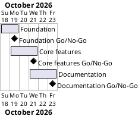

# Project Plan

## Metadata
| Key | Value |
| --- | --- |
| ID | PP-001 |
| CrossReference | [BC-001], [SA-001], [MIL-001], [MIL-002], [MIL-003] |
| Language | en |
| Domain | it |

## Version History
| Date | Status | Author | Reviewer | Change | Commit |
| --- | --- | --- | --- | --- | --- |
| 2026-10-18 | Accepted | Jens Tirsvad Nielsen | S01 | Initial version | [227594b] |

---

## Purpose

This plan schedules three gateways over the Business Case's constraint of about three days of effort, one pull request per gateway.

## Planning Assumptions

- Week 1 starts 2026-10-18; the plan ends by 2026-10-23.
- Phase length: one to two days.
- S01 owns every gateway and is the reviewer; in autonomous mode the AI acts as S01's stand-in and records it in the review.

## Gateway Schedule

| Gateway | Document | Window | Decision date | Owner | Stories | Main deliverable | Milestone |
| --- | --- | --- | --- | --- | --- | --- | --- |
| Foundation | [MIL-001] | 2026-10-18 to 2026-10-19 | 2026-10-19 | S01 | | Configured, CI-checked repository | |
| Core features | [MIL-002] | 2026-10-19 to 2026-10-21 | 2026-10-21 | S01 | UC-001 | Tested `stocknews` package | |
| Documentation | [MIL-003] | 2026-10-21 to 2026-10-23 | 2026-10-23 | S01 | | README, screenshots, three-language wiki | |



## Scope Coverage

| Business Case scope item | Gateway |
| --- | --- |
| Repository description and topics, CI workflows | [MIL-001] |
| `pyproject.toml`, `.gitignore`, `Doxyfile`, `constants.py` | [MIL-001] |
| Price, change, news, message and sending | [MIL-002] |
| Unit tests | [MIL-002] |
| README, screenshots, `.venv` guide | [MIL-001], [MIL-003] |
| Three-language wiki | [MIL-003] |

## Dependencies

```
Foundation → Core features → Documentation
```

A No-Go moves every later date by the time of the rework.

## Plan Risks

| Risk | Impact | Mitigation |
| --- | --- | --- |
| CI runner or secrets are not available on the git host | Workflows stay red or inactive | The workflows are installed and checked locally; the secrets are listed in the README for S01 |
| The git host API refuses the description or topic call | Metadata stays empty | Report it and set it by hand |

## Open Issues

- The wiki publishing workflow needs the secret `TOKEN_FOR_GITEA_WIKI` and an enabled wiki, which only S01 can create.
- The milestone publishing workflow needs a secret (`SYNC_TOKEN`) that only S01 can create; until then the issues are created with `sync-project.sh --apply` using the local token.

---

[BC-001]: ./business-case.md
[SA-001]: ./stakeholder-analysis.md
[MIL-001]: ./milestones/mil-001-foundation.md
[MIL-002]: ./milestones/mil-002-core-features.md
[MIL-003]: ./milestones/mil-003-documentation.md
[227594b]: https://git.tirsystem.com/Tirsvad-Udemy-100-days-of-code/036-stocknews/commit/227594bb0fb1d03545a66ddb64df77c61fa92fa8
