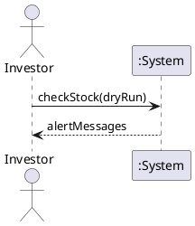

# System Sequence Diagram: Receive Stock News Alert

## Metadata
| Key | Value |
| --- | --- |
| ID | SSD-001 |
| CrossReference | [UC-001] |
| Language | en |
| Domain | it |

## Version History
| Date | Status | Author | Reviewer | Change | Commit |
| --- | --- | --- | --- | --- | --- |
| 2026-10-18 | Proposed | Jens Tirsvad Nielsen | AI as stand-in for S01 | Initial version | pending |

---

## Source Use Case

[UC-001] Receive Stock News Alert, main success scenario.

## Diagram

## System Operations Table

| Step | Message (verb phrase) | Parameters | Return | Use case step |
| --- | --- | --- | --- | --- |
| 1 | checkStock | dryRun | alertMessages (zero or more) | 1 to 6 |

The system fetches prices and news and sends messages inside this one operation; those exchanges are with external services and are not shown, because the system is a black box here.

## Lifecycle Notes

The System instance lives for one run of the program; nothing is stored between runs.

---

[UC-001]: ./uc.md
