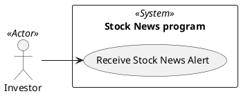

# Use Case Diagram

## Metadata
| Key | Value |
| --- | --- |
| ID | UCD-001 |
| CrossReference | [SA-001], [BC-001], [US-001], [UC-001] |
| Language | en |
| Domain | it |

## Version History
| Date | Status | Author | Reviewer | Change | Commit |
| --- | --- | --- | --- | --- | --- |
| 2026-10-18 | Proposed | Jens Tirsvad Nielsen | AI as stand-in for S01 | Initial version | pending |

---

## Purpose and Scope

The system boundary is the Stock News program. It is used by one actor, the investor (S01), who wants to learn why a stock moved. The diagram shows the single goal of the program.

## Diagram

## Actor Table

| Actor | Stereotype | Stakeholder ID (SA) | Goals (use cases) |
| --- | --- | --- | --- |
| Investor | <<Actor>> | S01 | Receive Stock News Alert |

## Use Case Table

| Use Case | Actor(s) | Goal |
| --- | --- | --- |
| Receive Stock News Alert | Investor | Be told, with the latest news, when the watched stock moved by the threshold |

## Relationships

There is no `<<include>>` or `<<extend>>` relationship: the program has one goal and no sub-goal that is reused.

---

[SA-001]: ./stakeholder-analysis.md
[BC-001]: ./business-case.md
[US-001]: ./user-stories.md
[UC-001]: ./uc-001/uc.md
